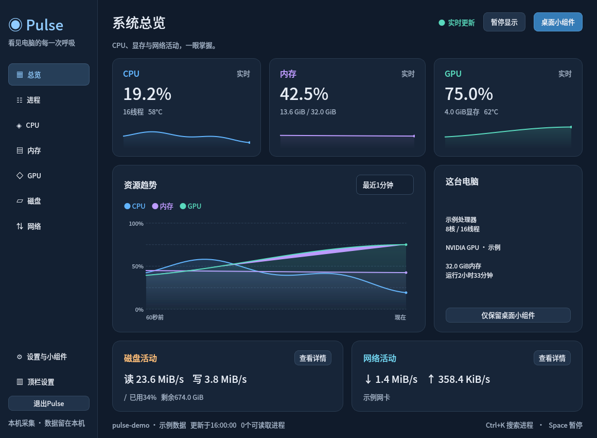
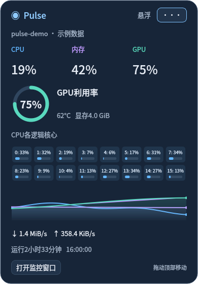

# Pulse · 系统资源监控

面向Ubuntu桌面的资源监控工具，把CPU、内存、NVIDIA GPU、磁盘与网络活动放进主窗口、GNOME顶栏和可拖动桌面小组件。使用Python、PySide6和psutil，后台由用户级systemd服务托管。



*界面预览使用构造的示例数据。实际运行时显示本机实时采样。*

## 功能

- **系统总览**：CPU、内存、GPU占用及最近1/3/5分钟趋势，磁盘与网络吞吐。
- **资源详情**：CPU逐逻辑核心负载、频率和可读温度；内存与交换空间；GPU利用率、显存、温度与功耗；挂载点容量和各网卡流量。
- **进程列表**：按名称、PID、用户搜索，按CPU、内存等列排序。
- **GNOME42图形顶栏**：位置、显示项目、趋势图、负载条、数字及配色可配置。
- **桌面小组件**：拖动定位，支持普通悬浮、置顶、桌面下层及不透明度调整。
- **后台运行**：关闭窗口后继续采集；支持登录自启动、单实例唤出和异常退出自动恢复。



## 支持环境

| 项目 | 当前支持与验证范围 |
| --- | --- |
| 操作系统 | Ubuntu22.04.5桌面，Linux的`/proc`与`/sys`采集入口 |
| 桌面 | GNOME42/X11；Wayland的小组件窗口层级由合成器决定 |
| Python | 已验证Python3.10.12 |
| Python依赖 | PySide6-Essentials6.11.2、psutil7.2.2 |
| GPU | NVIDIA，使用已安装驱动提供的`nvidia-smi`；无该工具时显示采集状态 |
| 原生图形顶栏 | GNOME42；其他GNOME版本使用AppIndicator数字顶栏入口，兼容性需按实际环境验证 |

## 安装与启动

以下命令面向Ubuntu22.04。系统软件包由用户安装，Pulse安装脚本写入当前用户目录。

### 1.准备系统依赖

```sh
sudo apt update
sudo apt install git python3-venv python3-pip python3-gi \
  gir1.2-gtk-3.0 gir1.2-ayatanaappindicator3-0.1 \
  gnome-shell-extension-appindicator fonts-noto-cjk libxcb-cursor0
```

数字顶栏需要在GNOME“扩展”应用中启用Ubuntu AppIndicators。NVIDIA指标使用本机驱动的`nvidia-smi`。

### 2.获取源码并安装Python依赖

```sh
git clone https://github.com/lvmixj/pulse-monitor.git
cd pulse-monitor
python3 -m venv .venv
.venv/bin/python -m pip install -r requirements.txt
```

使用uv时，可以用`uv venv --python python3 .venv`与`uv pip install --python .venv/bin/python -r requirements.txt`代替虚拟环境及依赖安装步骤。

### 3.安装桌面入口

```sh
python3 install.py
./run.sh
```

安装脚本生成应用菜单入口、用户级后台服务及顶栏启动器，在GNOME42上同时复制原生顶栏组件。源码和`.venv`继续保存在当前目录；移动目录后重新运行安装脚本，并重启Pulse服务。

应用菜单中搜索“Pulse 系统资源监控”。也可以只打开小组件：

```sh
./run.sh --widget
```

重复启动会唤出已有实例。关闭窗口后，采集与顶栏继续运行；通过顶栏菜单选择“退出Pulse监控”结束后台。

### 4.启用图形顶栏与登录自启动

首次安装GNOME42原生顶栏后，退出桌面会话并重新登录，然后运行：

```sh
gnome-extensions enable pulse-panel@local
```

顶栏菜单和主窗口侧栏均可打开“顶栏设置”，选择位置、指标、趋势图、负载条或纯数字。CPU/GPU/内存的百分比图形统一采用0–100%刻度，顶栏趋势保留60秒。

启用登录自启动并立即运行：

```sh
systemctl --user enable --now pulse-monitor.service
```

也可在应用设置页切换登录自启动。关闭自启动后，当前后台继续运行。

## 后台管理与卸载

```sh
systemctl --user status pulse-monitor.service
journalctl --user -u pulse-monitor.service -n 50
systemctl --user restart pulse-monitor.service
systemctl --user stop pulse-monitor.service
```

后台异常退出后由systemd在2秒后重启，每分钟最多自动启动5次。主动退出后保持停止，再次打开Pulse会重新启动服务。

卸载桌面集成：

```sh
python3 install.py --uninstall
```

卸载会停止Pulse服务，移除应用菜单、服务文件、顶栏组件和启动器，保留源码、`.venv`及用户偏好。用户偏好位于`~/.config/Pulse/ResourceMonitor.conf`，可按需另行删除。

## 数据与隐私

资源采集在本机执行，程序没有遥测上报、账号登录或远程服务接口。

主窗口会显示本机主机名、进程用户名、挂载路径和网卡IP；分享截图或诊断文件前检查这些内容。趋势历史仅在进程内保留最近5分钟。

- 用户偏好：`$XDG_CONFIG_HOME/Pulse/ResourceMonitor.conf`，默认`~/.config/Pulse/ResourceMonitor.conf`。
- 顶栏摘要：`$XDG_RUNTIME_DIR/pulse-monitor.json`，文件权限0600，包含资源数值与窗口状态。
- 原生顶栏心跳：`$XDG_RUNTIME_DIR/pulse-panel-native.json`。
- 应用菜单与顶栏文件：`$XDG_DATA_HOME`，默认`~/.local/share`。
- 后台日志：当前用户的systemd journal。

## 采集口径

- CPU利用率以全部逻辑核心为100%，进程CPU采用同一口径。
- 内存已用量为`total - available`；文件缓存单列。
- 网络与磁盘速率由累计计数差除以实际单调时间差计算。
- 磁盘汇总`/sys/block`下的物理设备，排除分区及loop/dm/md层的重复计数。
- 网络总速率汇总活动物理网卡，回环与虚拟接口在总量中排除，各接口在详情页单列。
- 多GPU在详情页分别列出，趋势、小组件和顶栏使用GPU0。
- 启动前的时间和不可用的GPU采样在曲线中保留空白。
- “暂停显示”冻结主窗口，后台与小组件继续更新。
- 进程退出或权限受限时跳过该进程，界面显示可读取进程数。

## 开发与验证

基础行为测试使用临时用户目录和Qt离屏平台：

```sh
QT_QPA_PLATFORM=offscreen .venv/bin/python -m unittest discover -s tests -p 'test_*.py' -v
```

真实桌面验收、依赖版本说明和目录结构见[开发文档](docs/DEVELOPMENT.md)。贡献方式见[CONTRIBUTING.md](CONTRIBUTING.md)。

## 许可证与参考

项目采用[MIT许可证](LICENSE)。第三方依赖许可和设计参考见[THIRD_PARTY.md](THIRD_PARTY.md)，界面布局说明见[DESIGN.md](DESIGN.md)。
